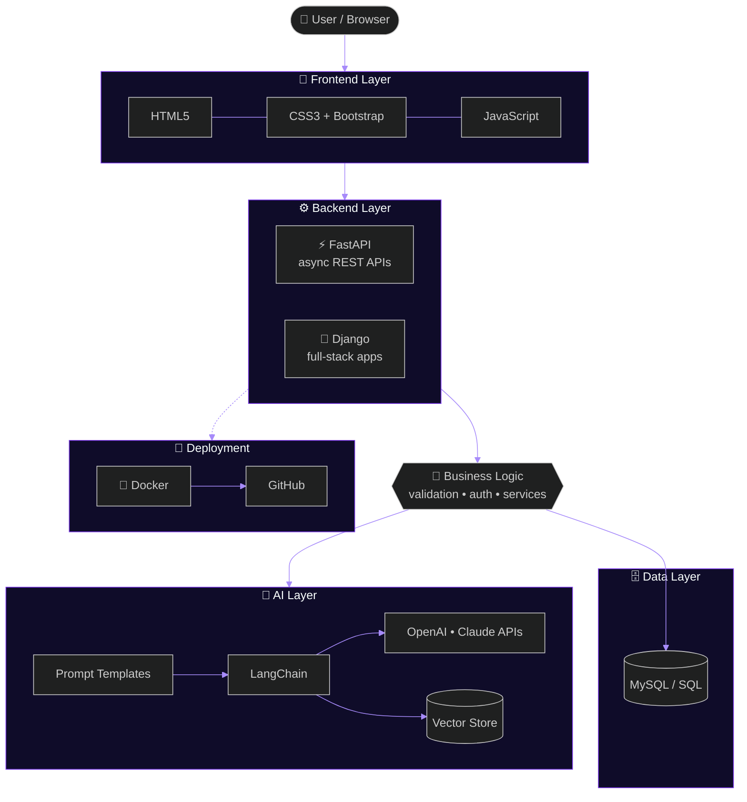
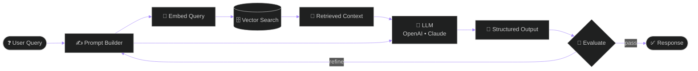

<!-- ═══════════════════════════ HERO ═══════════════════════════ -->

 

  

  

<!-- ═══════════════════════ DEVELOPER SHOWCASE ═══════════════════════ -->
## 🧑‍💻 Developer Showcase

<table align="center">
<tr>
<td align="center" width="260">

### **Kolkar Nisha**
`AI Engineer • Backend Developer`

</td>
<td width="620">

| 🎯 Current Focus | 🧠 Currently Learning |
|---|---|
| Building production-style **FastAPI & Django** backends | **Generative AI**, **OpenAI**, **Claude** |
| Shipping AI-powered projects (**GEN_AI_MASTER**) | **LangChain**, **RAG**, **Agents** |
| Daily SQL + DSA practice | **Vector Databases**, **Prompt Engineering** |
| Contributing consistently on GitHub | **AI Automation**, **Docker Deployment** |

| 🟢 Status | 🏆 Achievements |
|---|---|
| **Open to Work** — Python / Backend / AI roles | **959+** contributions in the last year |
| Based in **Bangalore, India** | **218** commits in November 2026 |
| Available for full-time & internships | **17** pull requests across **4** repositories |

</td>
</tr>
</table>

<!-- ═══════════════════════════ ABOUT ═══════════════════════════ -->
## 🌌 About Me

<table>
<tr>
<td width="50%" valign="top">

### 👩‍💻 Who I Am
I'm **Kolkar Nisha**, a Python Full Stack and Backend developer from **Bangalore** with a **B.Com in Computer Applications** — a blend of business thinking and engineering. I build APIs, web apps, and now AI-powered systems.

### 🧭 Engineering Philosophy
> *Write code that is simple to read, easy to test, and ready to scale.*

Clean structure first, cleverness never. Ship small, iterate fast, learn in public.

### 🛠️ What I Build
- REST APIs with **FastAPI** & **Django**
- Full-stack web applications
- Database-driven systems with **MySQL / SQL**
- **Generative AI** applications using LLM APIs

</td>
<td width="50%" valign="top">

### 🔭 Current Focus
- Going deep on **LLM application engineering**
- Building **RAG** pipelines and **agent** workflows
- Containerising projects with **Docker**

### 💡 What I Enjoy
- Solving problems with data structures & SQL
- Turning an idea into a working API
- Reading, breaking, and rebuilding open-source code

### 🤝 Why Companies Hire Me
- I **learn fast** and show it in public commits
- I understand the **business reason** behind a feature
- I pair solid **backend fundamentals** with modern **AI skills**
- Consistent output: **959+ contributions** in a year

</td>
</tr>
</table>

<!-- ═══════════════════════════ TECH STACK ═══════════════════════════ -->
## ⚡ Tech Stack

### 🐍 Backend Engineering
 
  

### 🎨 Frontend Engineering

### 🗄️ Database Systems
 

### 🤖 Generative AI

### 📈 Machine Learning *(Exploring)*
  

### 🧰 Developer Tools

### 🚢 DevOps & Cloud
  

### 🔀 Version Control

<!-- ═══════════════════════ ENGINEERING DASHBOARD ═══════════════════════ -->
## 📊 Engineering Dashboard

 

| 📌 Metric | 📈 Value | 🔎 Detail |
|:--|:--:|:--|
| **Contributions (last 12 months)** | `959+` | Steady activity, strongest from Aug → Nov 2026 |
| **Commits (Nov 2026)** | `218` | Spread across **18 repositories** |
| **Pull Requests (Nov 2026)** | `17` | **8 merged + 2 open** in NZJITSolutions, **3 merged** in daily_growth, **2 merged** in python_dsa_class, **1 merged + 1 open** in GEN_AI_MASTER |
| **Repositories Created (Nov 2026)** | `4` | GEN_AI_MASTER, NZJITSOLUTIONS_daily_growth, NZJITSolutions-KOLKARNISHA, research_new_things |
| **AI Projects** | `1+` | GEN_AI_MASTER |
| **Backend Projects** | `3+` | JOBNEX, PG SNAP, FarSay BondBridge |
| **Learning Progress** | 🟩🟩🟩🟩🟩🟩🟩⬜⬜⬜ | Python ▸ SQL ▸ Backend ▸ **GenAI (in progress)** |

<!-- ═══════════════════════ FEATURED PROJECTS ═══════════════════════ -->
## 🚀 Featured Projects

 

### 💼 1 · JOBNEX

| | |
|:--|:--|
| **Description** | A job-focused web application that connects candidates with opportunities through a structured, database-backed backend. |
| **Key Features** | Job listings • Search & filtering • Structured data models • Clean API/route design |
| **Tech Stack** | `Python` `FastAPI / Django` `SQL` `HTML` `CSS` `JavaScript` |
| **Business Impact** | Reduces the time from "searching" to "applying" by organising job data in one place. |
| **Architecture** | Client → Python backend → SQL database, with separated routes, models, and business logic. |
| **Repository** | [**github.com/kolkarnisha/jobnex**](https://github.com/kolkarnisha/jobnex) |

### 🤖 2 · GEN_AI_MASTER

| | |
|:--|:--|
| **Description** | My Generative AI lab: LLM applications, prompt design, and AI workflow experiments in one repository. |
| **Key Features** | LLM API integration • Prompt engineering • RAG & agent experiments • AI automation |
| **Tech Stack** | `Python` `TypeScript` `OpenAI` `Claude` `LangChain` |
| **Business Impact** | Shows I can turn modern LLM capabilities into working, automatable tools. |
| **Architecture** | App layer → LLM API layer → prompt/chain logic → structured output. |
| **Repository** | [**github.com/kolkarnisha/GEN_AI_MASTER**](https://github.com/kolkarnisha/GEN_AI_MASTER) |

### 🏠 3 · PG SNAP

| | |
|:--|:--|
| **Description** | A website to discover and compare PG (paying-guest) accommodation. |
| **Key Features** | Listing discovery • Location-based search • Responsive UI |
| **Tech Stack** | `Python` `HTML5` `CSS3` `Bootstrap` `JavaScript` `SQL` |
| **Business Impact** | Saves newcomers time when searching for housing in a new city. |
| **Architecture** | Responsive frontend → Python backend → relational database. |
| **Repository** | [**github.com/kolkarnisha/pg_snap_website_finder**](https://github.com/kolkarnisha/pg_snap_website_finder) |

### 🌉 4 · FarSay BondBridge

| | |
|:--|:--|
| **Description** | A relationship-and-connection focused application built to bridge people across distance. |
| **Key Features** | User-centred flows • Clean UI • Backend-driven logic |
| **Tech Stack** | `Python` `HTML` `CSS` `JavaScript` |
| **Business Impact** | Demonstrates product thinking: solving a real human problem end-to-end. |
| **Architecture** | Frontend → backend routes → data layer. |
| **Repository** | [**github.com/kolkarnisha/FarSay_BondBridge**](https://github.com/kolkarnisha/FarSay_BondBridge) |

### 🧮 5 · Python DSA

| | |
|:--|:--|
| **Description** | Daily data-structures-and-algorithms practice in Python. |
| **Key Features** | Arrays • Strings • Linked structures • Searching & sorting • Problem-solving patterns |
| **Tech Stack** | `Python` |
| **Business Impact** | Strong fundamentals → efficient, maintainable production code. |
| **Architecture** | Topic-wise modules with readable, tested solutions. |
| **Repository** | [**github.com/kolkarnisha/python-Data_structures_practice.python**](https://github.com/kolkarnisha/python-Data_structures_practice.python) |

### 🗃️ 6 · SQL Daily Practice

| | |
|:--|:--|
| **Description** | A running log of daily SQL problems and query-writing practice. |
| **Key Features** | Joins • Aggregations • Subqueries • Window functions • Query optimisation |
| **Tech Stack** | `SQL` `MySQL` |
| **Business Impact** | Reliable data querying is the backbone of every backend and AI pipeline. |
| **Architecture** | Problem → schema → query → explanation. |
| **Repository** | [**github.com/kolkarnisha/sql_daily_practice**](https://github.com/kolkarnisha/sql_daily_practice) |

<!-- ═══════════════════════ AI ROADMAP ═══════════════════════ -->
## 🧭 AI Engineering Roadmap

`🟢 Completed` &nbsp; `🟣 In Progress` &nbsp; `⚪ Up Next` &nbsp; `🌸 Goal`

<!-- ═══════════════════════ SYSTEM ARCHITECTURE ═══════════════════════ -->
## 🏗️ System Architecture

<!-- ═══════════════════════ OPEN SOURCE ZONE ═══════════════════════ -->
## 🌍 Open Source Contributions Zone

### 🔥 Contribution Graph

### 🟩 Contribution Heatmap

### 🐍 Contribution Snake

### ⚡ Contribution Streak

### 🏆 GitHub Trophies

### 📅 November 2026 Highlights

| Activity | Count | Where |
|:--|:--:|:--|
| ✅ Commits | **218** | 18 repositories |
| 🆕 Repositories created | **4** | `GEN_AI_MASTER` (TypeScript) • `NZJITSOLUTIONS_daily_growth` (HTML) • `NZJITSolutions-KOLKARNISHA` (Jupyter Notebook) • `research_new_things` |
| 🔀 Pull requests opened | **17** | `NZJITSolutions-KOLKARNISHA` • `NZJITSOLUTIONS_daily_growth` • `python_dsa_class` • `GEN_AI_MASTER` |
| 🟣 PRs merged | **14** | 8 + 3 + 2 + 1 |

<!-- ═══════════════════════ LIVE GITHUB DASHBOARD ═══════════════════════ -->
## 📡 Live GitHub Dashboard

 

 

 

 

<!-- ═══════════════════════ AI EXPERTISE ═══════════════════════ -->
## 🧠 AI Expertise Showcase

| 🧩 Capability | 📖 What it means in practice |
|:--|:--|
| **LLMs** | Calling and orchestrating OpenAI and Claude models from Python |
| **Prompt Engineering** | Clear instructions, examples, and constraints for dependable outputs |
| **Structured Outputs** | JSON / schema-validated responses that backends can trust |
| **Embeddings & Vector Search** | Semantic retrieval over private documents |
| **RAG** | Grounding answers in retrieved context to reduce hallucination |
| **LangChain & Agents** | Chaining steps and tools into autonomous workflows |
| **Model Evaluation** | Checking quality before shipping |
| **AI Automation** | Replacing repetitive manual work with LLM-powered pipelines |

<!-- ═══════════════════════ WHY HIRE ME ═══════════════════════ -->
## 💎 Why Hire Me

<table>
<tr>
<td width="33%" valign="top">

### ⚙️ Backend Engineering
Python, FastAPI, Django, and SQL — the core of reliable products.

### 🧩 Problem Solving
Daily DSA and SQL practice, all public in my repositories.

### ⚡ Fast Learning
Moved from web basics to Generative AI, visible in my commit history.

</td>
<td width="33%" valign="top">

### 🔌 API Development
Clean, documented REST APIs that frontends and AI layers can rely on.

### 🤖 AI Readiness
Hands-on with LLM APIs, prompts, RAG concepts, and agent workflows.

### 🏁 Project Ownership
I take features from idea → code → repository, and keep iterating.

</td>
<td width="33%" valign="top">

### 🤝 Team Collaboration
Comfortable with Git, branches, and pull requests — **17 PRs** opened in November alone.

### 📊 Business Perspective
My B.Com background helps me connect technical work to business value.

### 🗣️ Communication
Clear documentation, readable code, and straightforward updates.

</td>
</tr>
</table>

<!-- ═══════════════════════ CAREER JOURNEY ═══════════════════════ -->
## 🛤️ Career Journey Timeline

```mermaid
%%{init: {'theme':'dark','themeVariables':{'primaryColor':'#302b63','primaryBorderColor':'#00F5FF','lineColor':'#7C3AED','fontFamily':'monospace'}}}%%
flowchart LR
    A([🎓 B.Com<br/>Computer Applications]):::done --> B([🐍 Python]):::done
    B --> C([🗃️ SQL]):::done
    C --> D([🌐 Full Stack]):::done
    D --> E([⚙️ Backend]):::done
    E --> F([⚡ FastAPI]):::done
    F --> G([🤖 AI Engineering]):::now
    G --> H([🧠 LLMs]):::now
    H --> I([📚 RAG]):::next
    I --> J([🏭 AI Systems]):::next
    J --> K([🏛️ Future AI Architect]):::goal

    classDef done fill:#0f766e,stroke:#00F5FF,color:#fff
    classDef now fill:#7C3AED,stroke:#C4B5FD,color:#fff
    classDef next fill:#302b63,stroke:#7C3AED,color:#fff,stroke-dasharray: 4 3
    classDef goal fill:#DB2777,stroke:#F9A8D4,color:#fff,stroke-width:3px
```

<!-- ═══════════════════════ PRINCIPLES & MINDSET ═══════════════════════ -->
## 🧱 Engineering Principles & Developer Mindset

<table>
<tr>
<td width="50%" valign="top">

### 📐 Engineering Principles
1. **Readable beats clever.**
2. **Make it work → make it right → make it fast.**
3. **Small commits, clear messages.**
4. **Validate inputs, handle errors.**
5. **Document what you'd want to find.**

### 🔁 Daily Coding Philosophy
- 🌅 One DSA problem
- 🗃️ One SQL query
- 🛠️ One meaningful commit
- 📖 One new thing learned (`research_new_things`)

</td>
<td width="50%" valign="top">

### 🧠 Developer Mindset
- Curious first, confident second
- Treat bugs as teachers
- Build in public, improve in public
- Stay consistent — **959+ contributions** are built one day at a time

### 🎲 Fun Facts
- 🎓 I bring a **commerce** background into engineering
- 🏙️ Coding from the **Garden City of India**
- 📓 I keep a repo just for researching new things
- 🌱 My contribution graph keeps getting greener

</td>
</tr>
</table>

### 💬 Developer Quote
> **"Talk is cheap. Show me the code."** — *Linus Torvalds*

<!-- ═══════════════════════ GITHUB STARS & ACHIEVEMENTS ═══════════════════════ -->
## ⭐ GitHub Stars & Achievements

  

| 🏅 Achievement | Status |
|:--|:--:|
| 959+ contributions in a year | ✅ |
| 218 commits in a single month | ✅ |
| 17 pull requests opened (14 merged) | ✅ |
| 4 new repositories in one month | ✅ |
| Daily DSA + SQL practice maintained | ✅ |
| First production-grade RAG system | 🎯 In progress |

<!-- ═══════════════════════ RECRUITER CTA ═══════════════════════ -->
## 📬 Let's Build Something Great

  

  

<!-- ═══════════════════════ FOOTER ═══════════════════════ -->

 

### *"Learn daily. Build daily. Ship daily."*

