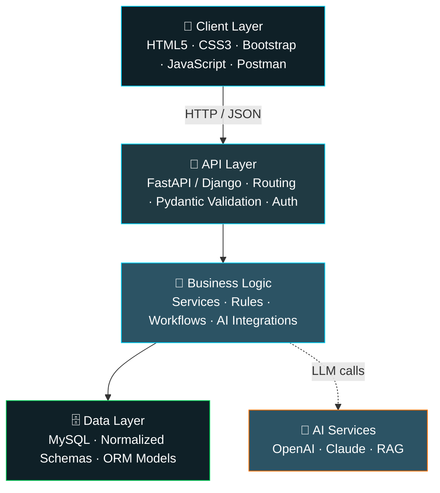
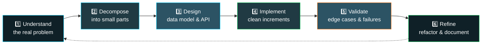
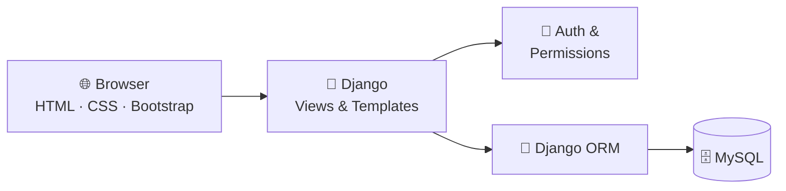
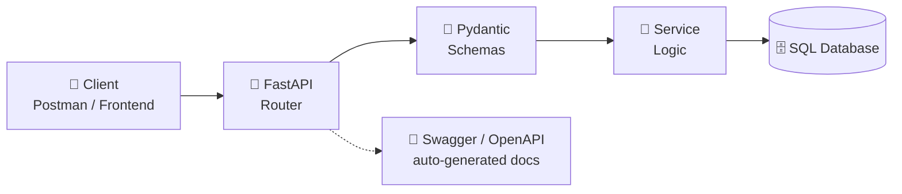

<div align="center">


<a href="https://git.io/typing-svg">
  
</a>

<br/><br/>


<br/><br/>


<br/>

<a href="https://www.linkedin.com/in/YOUR-LINKEDIN-USERNAME"></a>
<a href="mailto:your.email@example.com"></a>
<a href="#-featured-projects"></a>
<a href="https://github.com/YOUR-GITHUB-USERNAME?tab=repositories"></a>

<br/><br/>


</div>


<br/>

<table>
<tr>
<td width="62%" valign="top">

<h2>👩‍💻 Hi, I'm Nisha </h2>

I'm an engineer who solves real-world problems with **Python**, **backend development**, and **Generative AI**.

I design and build **database-driven web applications** and **REST APIs** using **FastAPI**, **Django**, and **MySQL**, with a focus on code that is readable, maintainable, and ready to scale. My foundation in **object-oriented programming**, **data structures & algorithms**, and **relational database design** means I think in systems, not just scripts.

I'm currently **expanding my expertise in Generative AI**: **LLM integration**, **RAG**, **LangChain**, **AI agents**, **vector databases**, and **prompt engineering**, to connect robust backend engineering with production-grade AI.

> 💡 **Engineering identity:** a fast learner who ships working software, writes code others can maintain, and raises the bar every day.

</td>
<td width="38%" align="center" valign="middle">


</td>
</tr>
</table>

<div align="center">

<table>
  <tr>
    <td align="center" width="25%"><br/><b>Python</b><br/><sub>Core Language</sub></td>
    <td align="center" width="25%"><br/><b>Backend</b><br/><sub>FastAPI • Django</sub></td>
    <td align="center" width="25%"><br/><b>Databases</b><br/><sub>SQL • MySQL</sub></td>
    <td align="center" width="25%"><br/><b>GenAI</b><br/><sub>LLMs • RAG • Agents</sub></td>
  </tr>
</table>

</div>


# 🚀 Engineering Philosophy

<table>
  <tr>
    <td width="18%" align="center"></td>
    <td>Code is read far more often than it is written. I favor clear naming, small focused functions, and consistent structure so any teammate can understand, review, and extend my work without friction.</td>
  </tr>
  <tr>
    <td align="center"></td>
    <td>I design with growth in mind: layered architecture, normalized schemas, validated inputs, and a clear separation between routes, business logic, and data access.</td>
  </tr>
  <tr>
    <td align="center"></td>
    <td>Technology moves fast. I treat learning as part of the job, turning each new concept into a working project instead of leaving it as theory.</td>
  </tr>
  <tr>
    <td align="center"></td>
    <td>I break problems into small, testable pieces, reason from first principles, and debug systematically instead of guessing.</td>
  </tr>
  <tr>
    <td align="center"></td>
    <td>AI is a powerful layer on top of strong backend engineering. Reliable APIs, clean data, and thoughtful prompts are what make AI features useful in production.</td>
  </tr>
</table>

---

## 🧑‍💻 About Me

```python
class KolkarNisha:
    """Backend-focused software engineer building reliable systems and AI-powered applications."""

    def __init__(self):
        self.name = "Kolkar Nisha"
        self.location = "Bangalore, Karnataka, India"
        self.education = "B.Com – Computer Applications"

        self.roles = [
            "Python Developer",
            "Python Full Stack Developer",
            "Backend Developer",
            "FastAPI Developer",
            "Django Developer",
            "Software Engineer",
            "AI Engineer",
            "Generative AI Developer",
            "LLM Engineer",
            "Data Analyst",
        ]

        self.expertise = {
            "languages": ["Python", "SQL", "JavaScript"],
            "backend": ["FastAPI", "Django", "REST APIs"],
            "frontend": ["HTML5", "CSS3", "Bootstrap", "JavaScript"],
            "databases": ["MySQL", "SQL"],
        }

        self.specialties = [
            "REST API design & documentation",
            "Database-driven web applications",
            "Authentication & authorization",
            "Request validation with Pydantic",
            "Prompt engineering for LLMs",
        ]

        self.current_focus = [
            "Generative AI & LLM applications",
            "RAG pipelines & vector databases",
            "LangChain & AI agents",
            "Docker & containerized deployment",
        ]

        self.architecture_style = "Layered, API-first, modular, and database-driven"

        self.development_principles = [
            "Write clean, readable, maintainable code",
            "Design APIs before writing endpoints",
            "Validate every input, document every endpoint",
            "Commit small, commit often, review honestly",
            "Learn by building real projects",
        ]

        self.career_goal = "Grow into a Backend & AI Engineer shipping production-grade AI systems."
        self.open_to_work = True

    def mission_statement(self):
        return (
            "Build reliable backend systems and intelligent AI applications "
            "that solve real problems for real people."
        )


if __name__ == "__main__":
    me = KolkarNisha()
    print(me.mission_statement())
```

---

# ⚡ Core Competencies

<div align="center">

| 🔧 Competency | 📌 What I Deliver |
|:---|:---|
| 🐍 **Python Development** | Object-oriented, readable, well-structured Python with strong fundamentals |
| ⚙️ **Backend Engineering** | CRUD systems, authentication & authorization, business logic with Django and FastAPI |
| 🔌 **API Engineering** | RESTful endpoints, Pydantic validation, Swagger/OpenAPI docs, Postman testing |
| 🗄️ **Database Design** | Normalized relational schemas, SQL queries, MySQL-backed applications |
| 🎨 **Full Stack Delivery** | Responsive interfaces with HTML5, CSS3, Bootstrap, and JavaScript connected to Python backends |
| 🤖 **Generative AI** | Prompt engineering, LLM API integration, RAG concepts, AI workflow design |
| 🧩 **Problem Solving** | Data structures & algorithms, systematic debugging, logical decomposition |
| 🔀 **Engineering Workflow** | Git/GitHub, SDLC, Agile collaboration |

</div>

---

## 🛠️ Technology Stack

<div align="center">

### ⚙️ Backend Engineering & API Development

<br/>


### 🎨 Frontend Development


### 🗄️ Databases

<br/>


### 🤖 Generative AI · 🧠 AI Engineering · ✍️ Prompt Engineering


<br/>


### 🧰 Development Tools · 🔀 Version Control · ☁️ Cloud & Deployment


### 🏛️ Software Architecture


</div>

---

# 🏗️ Architecture & Development Principles



| Principle | How I Apply It |
|:---|:---|
| 🧼 **Readable over clever** | Descriptive names, small functions, minimal nesting |
| 🧱 **Separation of concerns** | Routes, logic, and data access live in their own layers |
| ✅ **Validate at the boundary** | Pydantic models and Django forms protect every entry point |
| 📖 **Document as you build** | Swagger/OpenAPI docs and clear README files for every project |
| 🔁 **Iterate in small steps** | Frequent commits, incremental features, continuous refinement |
| 🔐 **Security by default** | Authentication, authorization, and safe handling of user data |

---

# 🤖 AI & GenAI Expertise

I'm building a practical bridge between **solid backend engineering** and **modern LLM systems**.

<div align="center">

| 🧠 Area | 🎯 Focus |
|:---|:---|
| ✍️ **Prompt Engineering** | Structured, reliable prompts and output formats for OpenAI and Claude models |
| 🔗 **LLM Integration** | Connecting language models to applications through APIs |
| ⚡ **FastAPI for AI** | Serving AI features through fast, validated, documented endpoints |
| 📚 **RAG Systems** | Grounding LLM answers in custom data using retrieval pipelines |
| 🗃️ **Vector Databases** | Embeddings and semantic search to power retrieval |
| ⛓️ **LangChain** | Orchestrating chains, tools, and multi-step LLM workflows |
| 🤖 **AI Agents** | Designing tool-using agents for multi-step tasks |
| 🐳 **Docker** | Packaging AI-powered backends for consistent deployment |

</div>

## 🗺️ AI Engineer Roadmap

```mermaid
flowchart LR
    A["🐍 Python"] --> B["⚙️ Backend<br/>Engineering"]
    B --> C["🔌 API<br/>Development"]
    C --> D["🧩 AI<br/>Integrations"]
    D --> E["🧠 LLMs"]
    E --> F["📚 RAG<br/>Systems"]
    F --> G["🗃️ Vector<br/>Databases"]
    G --> H["🤖 Agents"]
    H --> I["🚀 Production<br/>AI Systems"]

    style A fill:#3776AB,stroke:#ffffff,color:#ffffff
    style B fill:#092E20,stroke:#ffffff,color:#ffffff
    style C fill:#009688,stroke:#ffffff,color:#ffffff
    style D fill:#0A66C2,stroke:#ffffff,color:#ffffff
    style E fill:#6A1B9A,stroke:#ffffff,color:#ffffff
    style F fill:#00796B,stroke:#ffffff,color:#ffffff
    style G fill:#C2185B,stroke:#ffffff,color:#ffffff
    style H fill:#FF6F00,stroke:#ffffff,color:#ffffff
    style I fill:#00C853,stroke:#ffffff,color:#ffffff
```



---

# 📈 Growth Roadmap

<div align="center">

| Phase | Milestone | Progress | Status |
|:---:|:---|:---:|:---:|
| **1** | Python fundamentals, OOP, data structures & algorithms | `▰▰▰▰▰▰▰▰▰▰` | ✅ Established |
| **2** | SQL & MySQL database design | `▰▰▰▰▰▰▰▰▰▱` | ✅ Established |
| **3** | Full stack web development with Django, HTML, CSS, Bootstrap, JavaScript | `▰▰▰▰▰▰▰▰▱▱` | ✅ Established |
| **4** | REST API development with FastAPI | `▰▰▰▰▰▰▰▰▱▱` | ✅ Established |
| **5** | Prompt engineering & LLM API integration | `▰▰▰▰▰▱▱▱▱▱` | 🟢 Active |
| **6** | RAG pipelines, vector databases, LangChain | `▰▰▱▱▱▱▱▱▱▱` | 🟡 Next |
| **7** | AI agents & Docker-based deployment | `▰▱▱▱▱▱▱▱▱▱` | 🔵 Planned |
| **8** | Production-grade AI backends | `▱▱▱▱▱▱▱▱▱▱` | 🎯 Target |

</div>

---

# 🧠 Problem Solving Mindset



> *"Every bug is a puzzle, every feature is a design decision, and every project is a chance to engineer better."*

---

# 🌟 What Makes Me Different

<table>
  <tr>
    <td width="50%" valign="top">

### 🔀 Business + Tech Perspective
My B.Com background gives me a natural understanding of business workflows, records, and data, which helps me build software that fits how organizations actually operate.

    </td>
    <td width="50%" valign="top">

### 🧱 Backend Depth, AI Direction
I pair solid API and database engineering with hands-on movement into LLMs, RAG, and agents.

    </td>
  </tr>
  <tr>
    <td valign="top">

### ⚡ Learn-Build-Ship Loop
I turn new concepts into working projects quickly instead of stopping at tutorials.

    </td>
    <td valign="top">

### 📖 Documentation-First Habits
Clear API docs and readable code make my work easy for teams to adopt, review, and extend.

    </td>
  </tr>
</table>

---

# 🎯 Career Vision

<div align="center">

| 🌱 Now | 🌿 Next | 🌳 Long Term |
|:---:|:---:|:---:|
| Python / Backend / FastAPI / Django Developer | Backend & AI Integration Engineer | AI Engineer building production LLM systems |
| Ship reliable APIs & database-driven apps | Deliver RAG and agent-based features | Architect scalable, intelligent platforms |

</div>

---

## 🚀 Featured Projects

<details open>
<summary><b>📁 Django Management System: Full Stack CRUD Application</b></summary>

<br/>


<div align="center">

</div>

<br/>

**📖 Overview**
A full stack, database-driven management application built with **Django** and **MySQL** that lets users create, view, update, and delete structured records through a clean, responsive web interface.

**🎯 Problem Solved**
Manual record-keeping with spreadsheets and paper is slow, error-prone, and hard to search. This application centralizes data into a secure, organized, queryable system.

**✨ Key Features**
- ✅ CRUD-enabled management workflows for handling structured data efficiently
- ✅ Authentication and authorization mechanisms to protect application data
- ✅ Normalized relational schema in MySQL for reliable storage
- ✅ Responsive front end built with HTML5, CSS3, and Bootstrap

**🏗️ Architecture**



**📈 Impact**
Replaces manual record-keeping with an organized, searchable, and secure digital workflow, reducing data-entry errors and saving time on routine data management.

**💡 Lessons Learned**
Planning the relational schema before writing views, enforcing permissions consistently, and keeping templates and business logic cleanly separated made the codebase far easier to extend.

**🔗 GitHub:** [Browse My Repositories →](https://github.com/YOUR-GITHUB-USERNAME?tab=repositories)

</details>

<details open>
<summary><b>📁 FastAPI REST Service: High-Performance Backend API</b></summary>

<br/>


<div align="center">

</div>

<br/>

**📖 Overview**
A RESTful backend service built with **FastAPI** that exposes well-structured endpoints for data operations, with automatically generated interactive documentation.

**🎯 Problem Solved**
Front-end applications and other services need a fast, validated, well-documented API to integrate with. This service provides a reusable backend with a clear contract.

**✨ Key Features**
- ✅ REST endpoints with strict request and response validation using Pydantic
- ✅ CRUD operations backed by a SQL database
- ✅ Interactive API documentation through Swagger UI
- ✅ Endpoint testing with Postman and a codebase structured for maintainability

**🏗️ Architecture**



**📈 Impact**
Delivers a reusable, fast, self-documenting backend that shortens integration time and reduces malformed-request errors.

**💡 Lessons Learned**
Defining schemas first, validating at the boundary, and separating routes from logic keeps APIs predictable and simple to test as they grow.

**🔗 GitHub:** [Browse My Repositories →](https://github.com/YOUR-GITHUB-USERNAME?tab=repositories)

</details>

---

# 🛠 Current Engineering Focus

<table>
  <tr>
    <td width="30%"><b>🔭 Building</b></td>
    <td>Scalable backend systems with clean, layered architecture</td>
  </tr>
  <tr>
    <td><b>🧠 Expanding Expertise In</b></td>
    <td>Generative AI • LLM applications • RAG pipelines • LangChain • AI agents • Vector databases</td>
  </tr>
  <tr>
    <td><b>🐳 Deepening</b></td>
    <td>Docker, containerized deployment, and production-readiness practices</td>
  </tr>
  <tr>
    <td><b>💬 Ask Me About</b></td>
    <td>Python • Django • FastAPI • SQL • REST APIs • Prompt Engineering</td>
  </tr>
  <tr>
    <td><b>🤝 Open For</b></td>
    <td>Full-time roles • Internships • Freelance projects • Open source collaboration</td>
  </tr>
</table>

---

# 🚀 Open Source Journey

<div align="center">

| Stage | Focus |
|:---:|:---|
| 🌱 **Build** | Publishing well-documented projects with clear READMEs and clean commit history |
| 🔍 **Contribute** | Exploring Python, FastAPI, and Django repositories to contribute documentation fixes, bug reports, and small improvements |
| 🤝 **Collaborate** | Practicing pull requests, code reviews, and issue discussions in open source workflows |
| 🌍 **Impact** | Growing toward meaningful contributions to Python and AI tooling communities |

</div>

---

## 📊 GitHub Analytics

<div align="center">


<table> 
  <tr>
    <td align="center" width="50%">
      
    </td>
    <td align="center" width="50%">
      
    </td>
  </tr>
</table>


<br/><br/>


<br/><br/>


<br/><br/>


</div>

### 🏆 Trophy Section

<div align="center">


</div>

### 🐍 Contribution Snake

<div align="center">

<picture>
  <source media="(prefers-color-scheme: dark)" srcset="https://raw.githubusercontent.com/YOUR-GITHUB-USERNAME/YOUR-GITHUB-USERNAME/output/github-snake-dark.svg" />
  <source media="(prefers-color-scheme: light)" srcset="https://raw.githubusercontent.com/YOUR-GITHUB-USERNAME/YOUR-GITHUB-USERNAME/output/github-snake.svg" />
  
</picture>

</div>

### 🎖️ GitHub Achievements & Featured Technologies

<div align="center">


</div>

---

# 💼 Why Companies Hire Me

<div align="center">

| ✅ Strength | 💬 What It Means for Your Team |
|:---|:---|
| ⚡ **Fast Learner** | I pick up new frameworks quickly and apply them in real projects, shortening onboarding time |
| 🐍 **Strong Python Foundation** | Clean, object-oriented, maintainable code backed by solid fundamentals |
| ⚙️ **Backend Development** | Authentication, authorization, CRUD systems, and database-driven apps with Django and FastAPI |
| 🔌 **API Engineering** | Validated, documented, and tested REST APIs that front ends and services can rely on |
| 🤖 **AI Readiness** | Hands-on direction in LLMs, RAG, prompt engineering, and agent design for modern product needs |
| 🧩 **Problem Solving** | Structured debugging, algorithmic thinking, and calm ownership of hard problems |
| 🤝 **Team Collaboration** | Git workflows, Agile habits, clear communication, and openness to code review |
| 📊 **Business Understanding** | A commerce background that helps me connect technical decisions to business outcomes |

</div>

---

## 🧭 Daily Coding Philosophy

```python
while True:
    learn_something_new()
    build_something_real()
    write_clean_code()
    commit_early_and_often()
    review_and_refactor()
```

## 🎲 Fun Engineering Facts

- 🐍 Python is named after *Monty Python's Flying Circus*, not the snake.
- ⚡ FastAPI generates interactive API docs automatically from your type hints.
- 🐛 The term "bug" was popularized after an actual moth was found in a Harvard computer in 1947.
- 😄 My favorite upgrade path: *"it works on my machine"* → *"it works in production."*

---

## 🎓 Education & Training

| Type | Details |
|:---|:---|
| 🎓 **Degree** | Bachelor of Commerce (B.Com), Computer Applications |
| 💻 **Specialization** | Python Full Stack Development: Django, FastAPI, SQL, REST APIs, front-end fundamentals |
| 🤖 **Self-Directed Learning** | Generative AI, LLMs, RAG, LangChain, AI agents, vector databases, Docker |

---

## 📢 Open to Opportunities

<div align="center">


### Looking for a motivated engineer to strengthen your backend or AI team?

🎯 Python Developer &nbsp;|&nbsp; Backend Developer &nbsp;|&nbsp; Software Engineer <br/>
🎯 Python Full Stack Developer &nbsp;|&nbsp; FastAPI / Django Developer <br/>
🎯 Generative AI Developer &nbsp;|&nbsp; AI / LLM Engineer &nbsp;|&nbsp; Data Analyst <br/>
🎯 Internships &nbsp;|&nbsp; Freelance Projects &nbsp;|&nbsp; Open Source Collaboration

📍 **Based in Bangalore** • Open to **on-site, hybrid & remote** roles

<a href="mailto:your.email@example.com"></a>
<a href="https://www.linkedin.com/in/YOUR-LINKEDIN-USERNAME"></a>

</div>

---

## 🔍 Skills at a Glance

`Python Developer` • `Python Full Stack Developer` • `Backend Developer` • `Software Engineer` • `FastAPI Developer` • `Django Developer` • `REST API Developer` • `SQL Developer` • `MySQL` • `AI Engineer` • `Generative AI Developer` • `LLM Engineer` • `RAG` • `LangChain` • `Prompt Engineering` • `Vector Databases` • `Docker` • `Data Analyst` • `Git & GitHub` • `Agile & SDLC`

---

<div align="center">

### 💬 *"Good software is built one clean commit at a time."*


</div>
